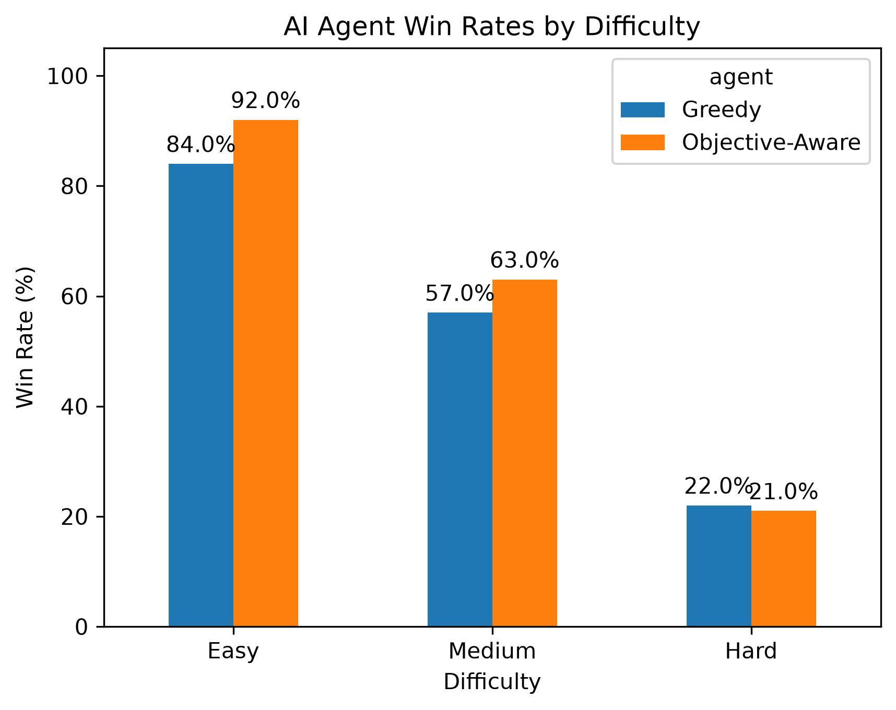
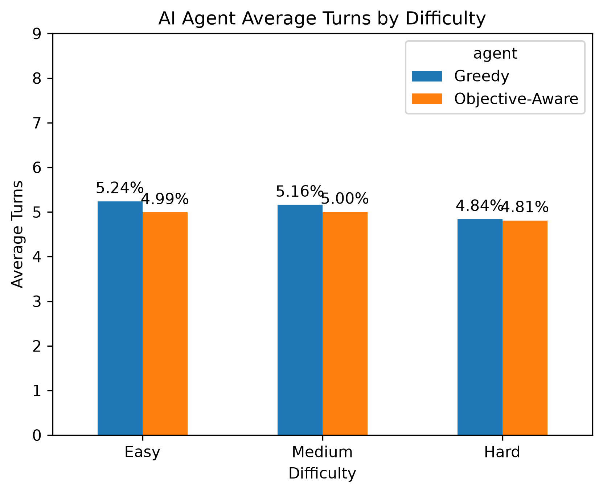

# Candy Crush AI

This project focuses on developing a match-three game environment and an AI agent that selects moves under configurable move limits, with the long-term goal of completing levels with specific objectives.

## Project Overview

Rather than simply recreating Candy Crush, the goal is to explore different AI approaches, beginning with heuristic-based decision-making and progressing toward machine learning and reinforcement learning.

## Current Features

- Object-oriented Python architecture with separate game, board, candy, and agent classes
- Randomized 5×5 game board generation
- Horizontal and vertical match detection
- Candy swapping and legal move validation
- Automatic match removal, gravity, and board refilling
- Cascading matches after moves
- Automated generation of available legal moves
- Automated move selection using heuristic scores
- Scoring system awarding points for candies cleared, including cascades
- Score and turn tracking with win/loss conditions
- Configurable move limits and target scores
- Refactored game logic with modular functions for match detection, power-up creation, and activation
- Automated unit tests using pytest for board generation, match detection, and multiple-match scenarios
- Initial special candy implementations:
  - Horizontal and vertical striped candies
  - Wrapped candies
  - Color bombs
- Objective-based levels requiring collection of specific candy types
- Tracking of collected candies across matches, cascades, and power-ups
- Board reshuffling when no valid moves are available
- Automated tests for objective completion, power-ups, and cascades
- Heuristic AI agent that evaluates valid moves based on immediate matches and level objectives
- Automated gameplay simulations for evaluating AI agent performance
- Reproducible benchmarks using fixed random seeds
- Greedy and objective-aware agent comparisons
- Configurable Easy, Medium, and Hard difficulty levels
- Performance analysis using pandas, including win rates, average scores, turns used, and candies collected
- Paired-game comparisons to identify which agent performs better on matching random seeds
- Data visualization using Matplotlib with grouped bar charts
- Export of simulation results, benchmark summaries, and visualizations to CSV and PNG files

## Planned Features

- Additional level objectives and more complex win conditions
- Advanced special candy combinations and interactions
- Improved heuristic evaluation considering future moves
- Game-state representation for machine learning
- Neural network-based move evaluation using PyTorch
- Reinforcement learning through simulated gameplay
- Comparison of heuristic and learned agent performance
- Optional graphical user interface

## AI Development Roadmap

### Phase 1: Game Environment — Implemented

Develop the core mechanics required for automated gameplay, including board generation, match detection, swapping, gravity, refilling, and cascading matches.

### Phase 2: Heuristic AI Agent — Implemented

Developed an AI agent capable of identifying valid moves,
evaluating matches, and selecting moves based on heuristic scores.

The agent supports objective-aware evaluation, prioritizing
candies needed to complete collection objectives.

### Phase 3: Objective-Based Gameplay — Implemented

Implemented candy collection objectives, configurable move limits,
objective tracking, and win/loss conditions.

Added support for board reshuffling and automated tests
covering objective tracking, power-ups, and cascades.

## AI Agent Benchmark Results

The project includes an automated benchmarking system that evaluates two heuristic agents:

- **Greedy Agent:** Selects moves based primarily on immediate matching opportunities.
- **Objective-Aware Agent:** Prioritizes moves that help complete candy collection objectives.

Both agents are evaluated across three difficulty levels using matching random seeds.

### Benchmark Configuration

| Difficulty | Move Limit | Target Candies | Games per Agent |
|---|---:|---:|---:|
| Easy | 8 | 10 | 100 |
| Medium | 6 | 12 | 100 |
| Hard | 5 | 15 | 100 |

A total of 600 games were simulated.

### Results

| Difficulty | Greedy Win Rate | Objective-Aware Win Rate |
|---|---:|---:|
| Easy | 84% | 92% |
| Medium | 57% | 63% |
| Hard | 22% | 21% |

Across all difficulties, the objective-aware agent achieved 40 wins in games where the greedy agent lost, compared with 27 wins for the greedy agent where the objective-aware agent lost.

This represents a net improvement of 13 wins across 300 paired game comparisons.

The objective-aware agent performed better on Easy and Medium levels, while both agents performed similarly on Hard levels.

These results establish an initial performance baseline for evaluating future machine learning agents.

### Benchmarking Tools

- **pandas:** Processes gameplay records and calculates performance metrics.
- **Matplotlib:** Generates grouped comparison charts.
- **CSV Export:** Saves individual simulation results and aggregated benchmark statistics.

Run the benchmark from the project root:

```bash
py -m benchmarks.benchmark
```

The script generates benchmark CSV files and charts comparing agent performance across difficulty levels.

### Phase 4: Machine Learning — Planned

Collect gameplay data and experiment with supervised learning models that predict move quality from board states and available actions.

### Phase 5: Reinforcement Learning — Planned

Train an agent through simulated gameplay using rewards based on scoring, objective completion, and move efficiency.

Evaluate performance against the heuristic-based agent.

## Technologies

- Python
- Object-Oriented Programming
- Heuristic Search and Decision-Making
- Artificial Intelligence
- pytest (Automated Unit Testing)
- pandas (Gameplay Data Analysis)
- Matplotlib (Benchmark Visualization)

### Planned Technologies

- NumPy
- PyTorch
- Reinforcement Learning

## Testing

The project uses pytest to validate game mechanics and AI behavior.

Current tests cover:
- Board initialization and match detection
- Valid and invalid swaps
- Special candy creation and activation
- Power-up chain reactions
- Color bomb activation
- Board reshuffling
- Candy collection through cascades
- Objective-based win/loss conditions
- Agent move evaluation and objective prioritization

Run tests from the project root:

```bash
py -m pytest tests/ -v
```

## Project Status

**Actively in Development**

The core match-three game environment is implemented, including candy swapping, match detection, cascades, special candies, scoring, objective-based gameplay, and board reshuffling.

Two heuristic AI strategies have been implemented: a greedy agent and an objective-aware agent that prioritizes collection objectives.

An automated benchmarking system evaluates both agents across three difficulty levels using reproducible gameplay simulations. Benchmark data is analyzed using pandas, with performance metrics exported to CSV files and visualized using Matplotlib.

Current development is transitioning toward machine learning, beginning with numerical game-state representations using NumPy and gameplay data collection for supervised learning.

Future development will introduce neural network-based move evaluation using PyTorch, followed by experiments with reinforcement learning.

### Benchmark Visualizations



