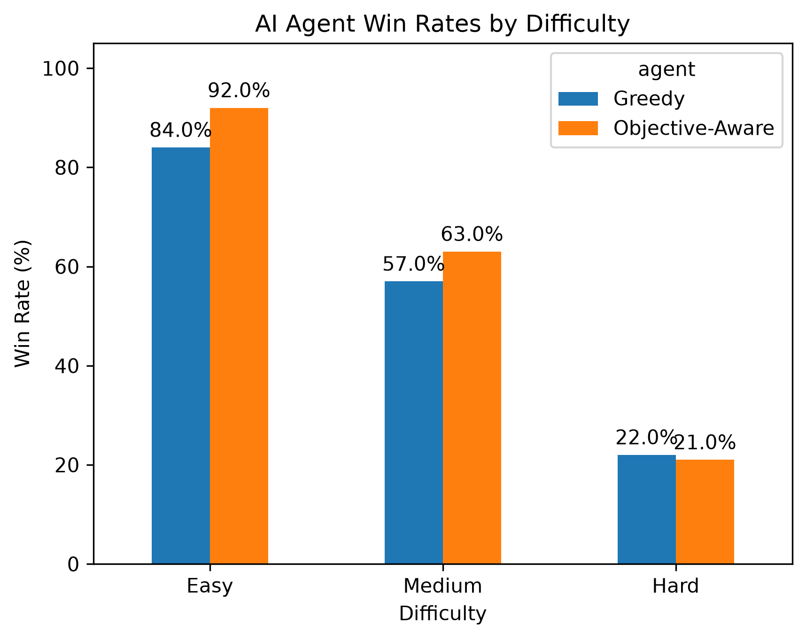
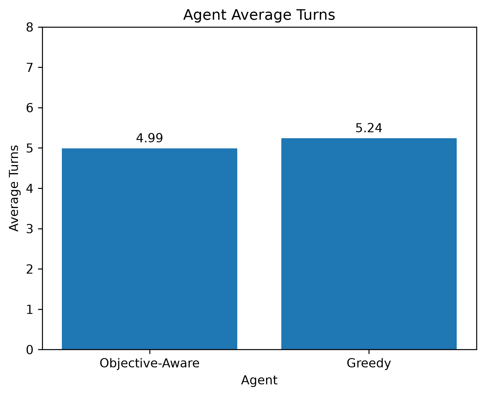

# Candy Crush AI

An AI-focused match-three game built in Python to explore heuristic search, supervised machine learning, and reinforcement learning through automated gameplay.

## Project Overview

This project develops a Candy Crush-style game environment where AI agents select moves to complete levels under configurable objectives and move limits.

Rather than simply recreating Candy Crush, the project compares different AI approaches, beginning with heuristic-based decision-making and progressing toward supervised learning and reinforcement learning.

## Current Features

### Game Environment
- Object-oriented Python architecture with separate board, candy, game, and agent classes
- Randomized 5×5 game board generation
- Horizontal and vertical match detection
- Legal move validation and automated move generation
- Automatic match removal, gravity, board refilling, and cascading matches
- Special candies, including horizontal and vertical striped candies, wrapped candies, and color bombs
- Board reshuffling when no valid moves are available
- Configurable move limits and candy collection objectives
- Score tracking, objective progress, and win/loss conditions
- Automated tests using pytest

### AI Agents
- Greedy agent prioritizing immediate matching opportunities
- Objective-aware agent prioritizing moves that collect target candies
- PyTorch neural network trained to predict heuristic move scores
- ML agent that evaluates legal moves and selects the highest-scoring prediction
- Batched model inference using PyTorch
- Saved model checkpoints for inference

### Machine Learning Pipeline
- Game-state and move encoding using NumPy
- 180-feature representation of board states, special candies, move coordinates, and level objectives
- Automated supervised dataset generation from heuristic gameplay
- Separate training, validation, and test datasets
- Fully connected neural network implemented in PyTorch
- Model training using the Adam optimizer and mean squared error loss
- Validation-based model checkpointing
- Held-out test evaluation against a constant-mean prediction baseline

### Benchmarking and Analysis
- Automated gameplay simulations using fixed random seeds
- Easy, Medium, and Hard difficulty configurations
- Comparisons between Greedy, Objective-Aware, and ML agents
- Win rate, average score, average turns, and objective completion metrics
- Statistical analysis using pandas
- Visualization using Matplotlib
- CSV exports of heuristic benchmark results and summaries

## AI Development Roadmap

### Phase 1: Game Environment — Implemented

Developed the core match-three environment, including board generation, match detection, swapping, gravity, refilling, cascades, and special candies.

### Phase 2: Heuristic AI Agents — Implemented

Developed greedy and objective-aware agents that evaluate valid moves using immediate matching opportunities and level objectives.

### Phase 3: Objective-Based Gameplay — Implemented

Implemented candy collection objectives, configurable move limits, objective tracking, win/loss conditions, and board reshuffling.

Added automated tests for move validation, special candies, objective tracking, and gameplay mechanics.

### Phase 4: Supervised Machine Learning — Implemented, Improving Performance

Developed a supervised learning pipeline that generates labeled move-evaluation data using heuristic gameplay.

Created a 180-feature representation of the board state and candidate move, including candy colors, special candies, move coordinates, and target objectives.

Implemented a fully connected PyTorch neural network with two hidden layers to predict heuristic move scores.

Added training, validation, and test evaluation, checkpoint saving/loading, and a neural-network-powered ML agent.

Integrated the ML agent into the game environment and evaluated its performance across 300 simulated games.

Current improvements focus on move-ranking accuracy, generalization, and gameplay performance relative to heuristic agents.

### Phase 5: Reinforcement Learning — Planned

Train an agent through simulated gameplay using rewards based on scoring, objective completion, and move efficiency.

Compare reinforcement learning performance against supervised and heuristic agents.

## AI Agent Benchmark Results

The project evaluates three AI approaches:

- **Greedy Agent:** Selects moves based on immediate matching opportunities.
- **Objective-Aware Agent:** Prioritizes moves that help complete candy collection objectives.
- **ML Agent:** Uses a trained PyTorch neural network to predict move scores and select actions.

### Benchmark Configuration

| Difficulty | Move Limit | Target Candies | Games per Agent |
|---|---:|---:|---:|
| Easy | 8 | 10 | 100 |
| Medium | 6 | 12 | 100 |
| Hard | 5 | 15 | 100 |

A total of **900 benchmark games** have been evaluated across the three agents and difficulty levels: 600 heuristic-agent games and 300 ML-agent games.

### Win Rate Results

| Difficulty | Greedy | Objective-Aware | ML Agent |
|---|---:|---:|---:|
| Easy | 84% | 92% | 68% |
| Medium | 57% | 63% | 33% |
| Hard | 22% | 21% | 7% |

The objective-aware agent achieved the highest win rates on Easy and Medium difficulties.

The ML agent successfully completed levels across all difficulties but currently performs below the heuristic agents.

Because the supervised model was trained to approximate heuristic scores, imperfect predictions can cause it to select suboptimal moves.

These results establish a baseline for improving supervised move selection and evaluating future reinforcement learning agents.

### ML Agent Performance

| Metric | Easy | Medium | Hard |
|---|---:|---:|---:|
| Win Rate | 68% | 33% | 7% |
| Average Score | 411.30 | 356.20 | 322.20 |
| Average Turns | 6.45 | 5.59 | 4.98 |
| Average Target Candies Collected | 10.39 | 8.94 | 7.89 |

### Supervised Model Evaluation

The model was evaluated using a held-out test dataset.

- Neural network test MSE: 6.81
- Constant-mean baseline test MSE: 6.40

The neural network has not yet outperformed the constant-mean baseline on prediction accuracy.

Future evaluation will focus on move-ranking accuracy and whether the model selects moves that maximize objective completion.

## Technologies

- **Python:** Game logic, simulation, and AI development
- **PyTorch:** Neural network training and inference
- **NumPy:** Board-state encoding and feature engineering
- **pandas:** Gameplay analysis and benchmark summaries
- **Matplotlib:** Benchmark visualization
- **pytest:** Automated testing
- **Git/GitHub:** Version control

## Running the Project

Run the main gameplay simulation from the project root:

```bash
py main.py
```

The agent can be selected in `main.py` by initializing the desired agent class.

To run gameplay using the ML agent, a trained model checkpoint (`best_move_model.pth`) must be available in the project root.

Model checkpoint files are excluded from version control and must be generated through the training pipeline.

## Benchmarking

Run the original heuristic-agent benchmark:

```bash
py -m benchmarks.benchmark
```

This benchmark evaluates Greedy and Objective-Aware agents and generates CSV results and comparison charts.

Run the supervised ML-agent benchmark:

```bash
py -m benchmarks.benchmark_ml
```

This evaluates the trained ML agent across Easy, Medium, and Hard difficulty levels.

## Testing

The project uses pytest to validate game mechanics and AI behavior.

Current tests include:

- Board initialization and match detection
- Valid and invalid swaps
- Special candy creation and activation
- Power-up chain reactions
- Color bomb activation
- Objective-based win/loss conditions
- Agent move evaluation and objective prioritization
- Machine learning feature encoding
- ML agent legal move selection

Run the test suite from the project root:

```bash
py -m pytest tests/ -v
```

## Project Status

**Actively in Development**

The core match-three game environment, objective-based gameplay, heuristic agents, and automated benchmarking systems are implemented.

The project now includes a supervised machine learning pipeline and a PyTorch-powered agent capable of selecting moves and completing levels.

The supervised agent has been evaluated across 300 games and currently achieves win rates of 68% on Easy, 33% on Medium, and 7% on Hard.

Current development focuses on improving the supervised model's move-ranking accuracy and evaluating its decision-making relative to heuristic agents.

Future work will introduce reinforcement learning through simulated gameplay.

## Benchmark Visualizations

### AI Agent Win Rates



### AI Agent Average Turns

